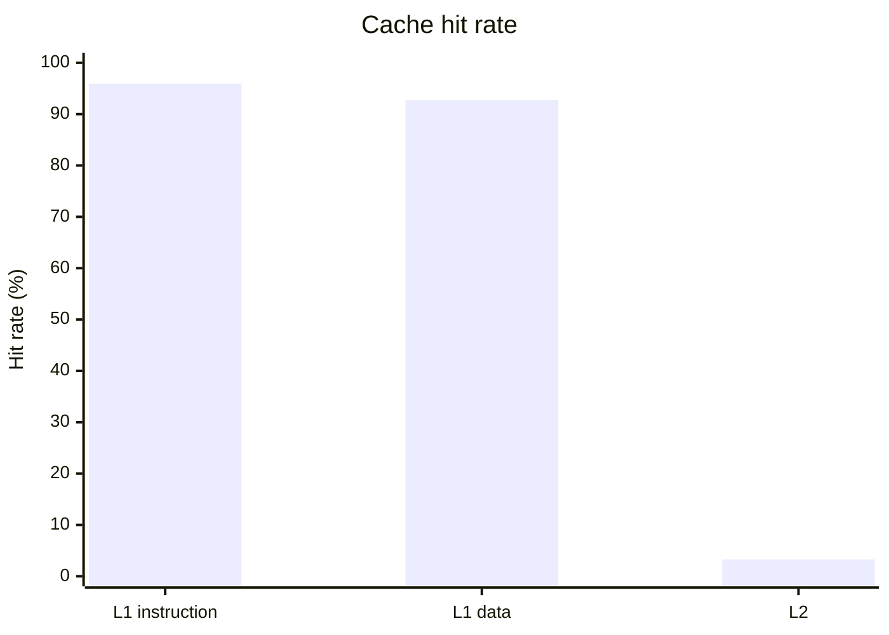
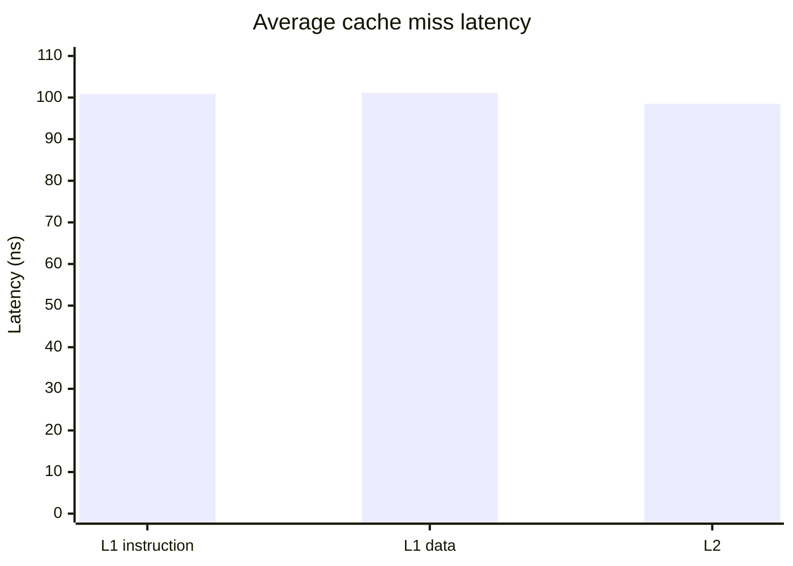

# gem5 X86 Hello-World Exercise Report

## Objective

Build gem5 for X86 and run a Linux hello-world executable in syscall-emulation
(SE) mode using a custom configuration script.

## Steps followed

1. Built the X86 gem5 simulator:

   ```sh
   scons build/X86/gem5.opt -j4
   ```

   The initial SCons checks reported that `-Wno-volatile` and
   `-Wl,--as-needed` were unsupported. These were optional flag checks on
   macOS, not the fatal error. The initial Python embedding check failed
   because the C++ standard header `cstddef` could not be found; after the
   Python/compiler environment was corrected, the build proceeded.

2. Used a Linux executable rather than a macOS executable. The macOS-built
   binary was Mach-O and incompatible with gem5's X86 Linux SE workload.
   The program was compiled in a Linux AMD64 Docker environment:

   ```sh
   docker run --rm --platform linux/amd64 \
     -v /Users/arijeet/Projects:/src -w /src \
     gcc:12 gcc -static -O2 -o hello-linux Helloworld.c
   ```

   `file /Users/arijeet/Projects/hello-linux` identified it as a statically
   linked x86-64 Linux ELF executable.

3. Updated `configs/example/x86/hello_world.py` to:
   - Import cache helpers from `common.Caches` and SimObjects from
     `m5.objects`.
   - Create a `SystemXBar`, a `MemCtrl` with a DDR3 interface, a
     `TimingSimpleCPU`, and L1 instruction/data caches.
   - Connect the CPU caches, memory controller, system port, and X86
     interrupt-controller ports to the bus.
   - Accept the executable path through `-c`, initialize the SE workload,
     and assign a `Process` to the CPU.

4. Ran the configuration and directed output to a dedicated directory:

   ```sh
   ./build/X86/gem5.opt -d m5out/hello \
     configs/example/x86/hello_world.py \
     -c /Users/arijeet/Projects/hello-linux
   ```

## Output obtained

The simulation completed and the guest program printed:

```text
Hello, World!
Exiting @ tick 79209000 because exiting with last active thread context
```

The run generated `config.ini`, `config.json`, `citations.bib`, and
`stats.txt` in `m5out/hello/`. The stats file contains 843 lines and reports:

| Metric | Value |
|---|---:|
| Simulated time | 0.000079 seconds |
| Simulated ticks | 79,209,000 |
| Simulated instructions | 9,669 |
| Simulated operations | 16,323 |
| Host elapsed time | 0.01 seconds |

## Cache performance baseline

The cache statistics below are from `m5out/base_config/stats.txt`, which
records a 64-byte block size, 32 KiB 1-way L1 instruction cache, 64 KiB
1-way L1 data cache, and 512 KiB 2-way L2 cache. Hit and miss rates are
calculated as hits or misses divided by total cache accesses.

| Cache | Accesses | Hits | Misses | Hit rate | Miss rate | Average miss latency |
|---|---:|---:|---:|---:|---:|---:|
| L1 instruction | 12,732 | 12,214 | 518 | 95.93% | 4.07% | 100,872.59 ticks (100.873 ns) |
| L1 data | 3,821 | 3,546 | 275 | 92.80% | 7.20% | 101,116.36 ticks (101.116 ns) |
| L2 (combined) | 794 | 26 | 768 | 3.27% | 96.73% | 98,496.09 ticks (98.496 ns) |

### Cache hit and miss rates





Miss rate is the complement of hit rate (100% minus hit rate). The table
above retains exact access, hit, miss, and latency values.

The memory controller's average read access latency was 27,241 ticks
(27.241 ns) for instruction reads and 27,045.71 ticks (27.046 ns) for data
reads. In this run, gem5 uses 1 trillion ticks per simulated second, so
1,000 ticks equal 1 ns. Cache miss latency and memory-controller read latency
are different metrics: the former is measured at the cache, while the latter
is measured at the memory controller.

During troubleshooting, the output directory was empty when a run aborted
before simulation. A successful run was subsequently performed, and the
current `m5out/hello/stats.txt` is populated.

## Warnings and observations

- gem5 warned that `512MB` and `32kB` use decimal units and were cast to
  `512MiB` and `32KiB`. Use binary-unit spellings explicitly to avoid these
  warnings.
- The selected DDR3 device reports 8192 MiB capacity, while the configured
  address range is 512 MiB. This mismatch did not prevent the hello-world
  simulation from completing, but the device and system memory configuration
  should be made consistent for subsequent experiments.
- `-j4` is an SCons build parallelism option. `-d m5out/hello` is a gem5
  simulator option and belongs on the run command.
- The guest program's `Hello, World!` output was visible in the terminal.
  gem5's simulation statistics are written separately to `stats.txt`.

## Lessons learned

1. A 64-bit executable is not necessarily compatible with gem5: the guest ISA
   and executable format must match the simulation. For X86 Linux SE, use an
   x86-64 Linux ELF binary, not a macOS Mach-O executable or a C source file.
2. gem5 configuration scripts must wire all required SimObject ports. An X86
   interrupt controller needs its PIO, interrupt-request, and interrupt-
   response ports connected.
3. `SEWorkload` describes the syscall-emulation workload; the CPU's
   `workload` parameter is a `Process` containing the executable command.
4. gem5's run output directory is chosen at runtime with `-d`. Statistics are
   written after a run reaches a statistics dump; an early panic can leave an
   empty `stats.txt`.
5. Read the actual compiler/configuration error and gem5 panic message rather
   than treating every preceding warning as fatal.
